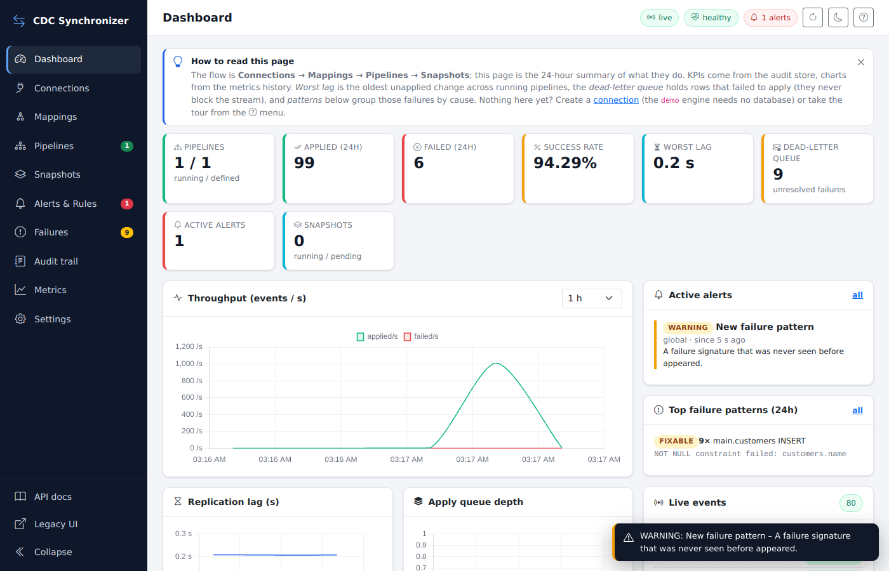

# CDC Database Synchronizer (strangler-fig data migrator)

Change-data-capture based migration out of legacy databases – keep the legacy system running,
capture its changes, build the new solution next to it and move consumers over one by one, with
documentation, auditing and alerting from day one.




## What it does

|                         |                                                                                                                                                                                                                                                                                |
|-------------------------|--------------------------------------------------------------------------------------------------------------------------------------------------------------------------------------------------------------------------------------------------------------------------------|
| **Sources**             | SQL Server (CDC), PostgreSQL (logical slots), MariaDB/MySQL (binlog), MongoDB (change streams), Oracle (LogMiner) – prerequisite checks with fix hints, capture enable/disable, event-driven reading (one watermark query, adaptive back-off, push where the engine offers it) |
| **Destinations**        | SQL Server, PostgreSQL, MariaDB/MySQL, Oracle, SQLite – idempotent upserts; optional Kafka/Confluent mirror of every change                                                                                                                                                    |
| **Pipelines**           | at-least-once with positions committed after apply, batch application with poison-row isolation, real key resolution, DuckDB transformations and column controls                                                                                                               |
| **Snapshots**           | chunked keyset initial loads: resumable, throttled, maintenance windows, hand-off to CDC – built for multi-TB tables                                                                                                                                                           |
| **Auditing & alerting** | audit trail, dead-letter queue with replay, failure-pattern mining with one-click fixes, rule sets (pipeline health, data-loss guard, failures, snapshots, configuration), webhook / e-mail / in-app channels, Prometheus metrics                                              |
| **UI**                  | single-page application, no build step, no CDN; a built-in demo engine to try everything without a database                                                                                                                                                                    |
| **Storage**             | transactional SQLite state store with versioning; secrets by reference; automatic migration of the 1.x JSON files                                                                                                                                                              |

## Quick start

```bash
python -m venv venv && source venv/bin/activate      # Windows: venv\Scripts\activate
pip install -r requirements.txt
python verify_setup.py
python main.py                                       # http://localhost:8000  (API docs: /docs)
pytest                                               # unit + API tests, no databases needed
```

Then follow the ten-minute demo tour in the [getting-started guide](docs/user-guide/01-getting-started.md).

## Documentation

* **[User guide](docs/README.md#for-operators-data-engineers-and-architects--user-guide)** – getting started, UI, connections & CDC prerequisites, mappings, pipelines & snapshots, monitoring & alerting, operations runbook.
* **[Developer guide](docs/README.md#for-developers--developer-guide)** – architecture, connectors, storage, audit internals, frontend, testing, history (1.x code review, inspection triage, change log).
* **[Configuration reference](docs/reference/configuration.md)** – environment variables, connection/mapping/pipeline/snapshot/rule schemas, API map.

## Layout

```
backend/        FastAPI app, connectors, destinations, core (pipeline, applier, snapshots, audit, metrics), storage
frontend/app/   the SPA;  frontend/templates + static: 1.x pages (served under /legacy)
docs/           user guide · developer guide · reference · screenshots
tests/          unit · integration (API, live connectors) · perf · ui (browser)
docker/         docker-compose with CDC-ready SQL Server, PostgreSQL, MariaDB, MongoDB, Oracle for live tests
duckdb_scripts/ transformation script templates
```

## License

MIT – see `LICENSE`.
